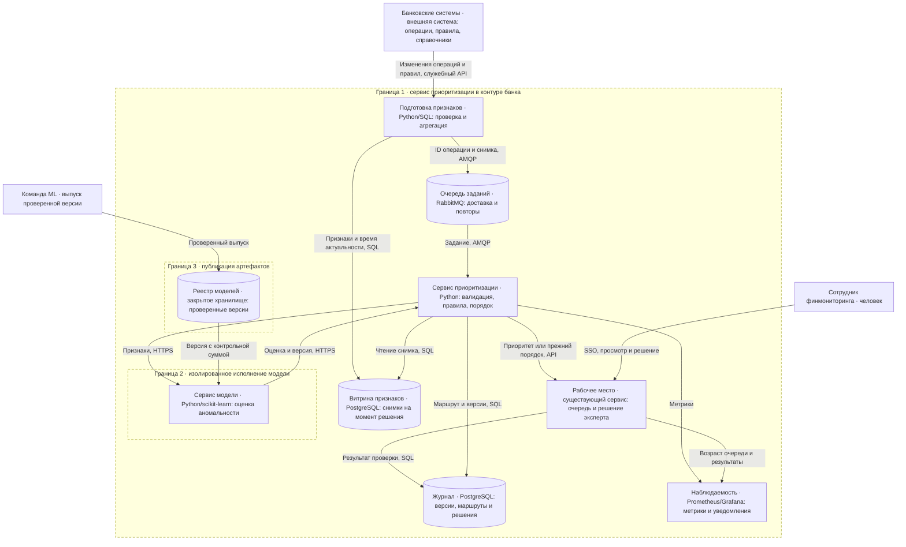
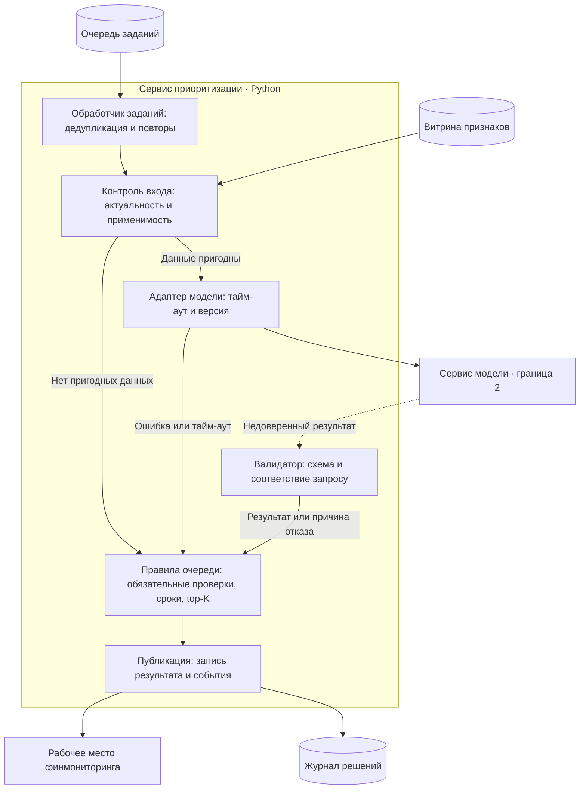

# Архитектура приоритизации операций

## Задача и границы

Модель помогает финмониторингу выбирать операции для проверки из уже помеченных правилами и внешними сигналами — около 35 тысяч в месяц.

Она не подтверждает схему, не разрешает платёж и не блокирует клиента. Обязательные проверки и сроки сохраняются независимо от оценки модели.

Начальный кандидат — Isolation Forest. LOF проверяем как альтернативу. LLM, поиск по документам и агенты здесь не нужны: первая версия работает с табличными признаками.

## C4 Container

Все новые контейнеры размещаются в контуре банка. Пунктирные рамки обозначают границы доверия; номера используются в таблице безопасности.



Банковские системы находятся за границей сервиса, но внутри банка. Передача данных внешнему провайдеру для флагмана не предусмотрена.

## C4 Component: сервис приоритизации

Сервис модели, очередь, витрина и рабочее место — внешние по отношению к этому контейнеру.



## Ответственность компонентов

| Компонент | Что делает | Владелец |
|---|---|---|
| Подготовка и витрина | Считает признаки только из данных, доступных на момент решения | Команда данных |
| Очередь и обработчик | Не теряют задания, исключают повторное применение результата | Команда сервиса |
| Контроль входа | Проверяет полноту, свежесть, наличие истории и известность сегмента | Команда сервиса + ML |
| Модель | Возвращает оценку нетипичности | ML-команда |
| Валидатор | Проверяет структуру, диапазоны, ID и версии | Команда сервиса |
| Правила очереди | Сохраняют обязательные проверки и сроки; применяют приоритет | Финмониторинг + команда сервиса |
| Рабочее место | Показывает факты и принимает решение сотрудника | Финмониторинг |
| Журнал и мониторинг | Дают возможность объяснить результат и восстановить ход обработки | Эксплуатация |

## Режим работы

- Признаки обновляются по изменениям операций; накопительные показатели считаются инкрементально по всему потоку.
- Помеченные операции пересчитываются асинхронно каждые 15 минут. Это стартовое допущение для нагрузочного теста.
- Обработка не стоит на пути проведения платежа.
- Тайм-аут модели — 30 секунд, затем не более двух повторов. После этого используется прежний порядок.
- Ключ обработки: `operation_id + feature_snapshot_id + model_version + policy_version`.
- Результат и событие публикации сохраняются транзакционно через outbox. Повтор не создаёт второй кейс.
- Устаревший результат не заменяет более новый.

K — доступное число проверок после обязательных кейсов и контрольной выборки. Его определяет руководитель смены по доступным часам, а не фиксирует модель.

Модель ранжирует только оставшуюся часть очереди. Старые кейсы нельзя бесконечно отодвигать: срок и возраст очереди имеют приоритет над score.

## Выходной контракт

Пример результата сервиса:

```json
{
  "schema_version": "1.0",
  "operation_id": "op-123",
  "source_ref": "operations/op-123",
  "feature_snapshot_id": "fs-456",
  "features_as_of": "2026-11-17T10:00:00Z",
  "scored_at": "2026-11-17T10:05:00Z",
  "model_version": "iforest-0.1",
  "policy_version": "queue-0.1",
  "status": "scored",
  "anomaly_score": 0.94,
  "reason_codes": ["UNUSUAL_TURNOVER"],
  "route": "ranked_review"
}
```

`anomaly_score` — процентиль нетипичности относительно фиксированной эталонной выборки версии модели, от 0 до 1. Это не вероятность схемы. Преобразование исходной оценки проверяется на validation-наборе; вероятностная калибровка без надёжных меток не используется.

| Проверка | Правило |
|---|---|
| Структура | Обязательные поля присутствуют, неизвестные поля запрещены |
| Соответствие | ID операции, снимка и модели совпадают с заданием |
| Оценка | Конечное число от 0 до 1; отсутствует при `not_scored` |
| Источник | Ссылка ведёт на существующую операцию, доступную сотруднику |
| Актуальность | Снимок не старше 30 минут; исключения для исторических данных задаются явно |
| Причины | Только коды из справочника, подтверждённые признаками |
| Маршрут | `ranked_review` или `baseline_review`; решение по платежу отсутствует |

При нехватке данных возвращаются `status=not_scored`, `anomaly_score=null`, причина и `route=baseline_review`. Ошибочный ответ не меняет очередь.

Причины показываются как наблюдаемые отклонения, а не как доказательство нарушения. Низкий score не означает, что операция безопасна.
