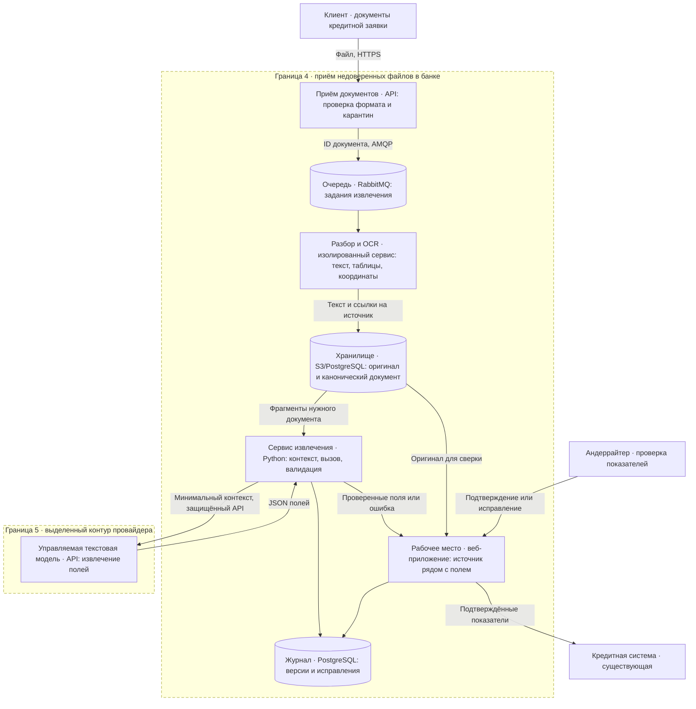
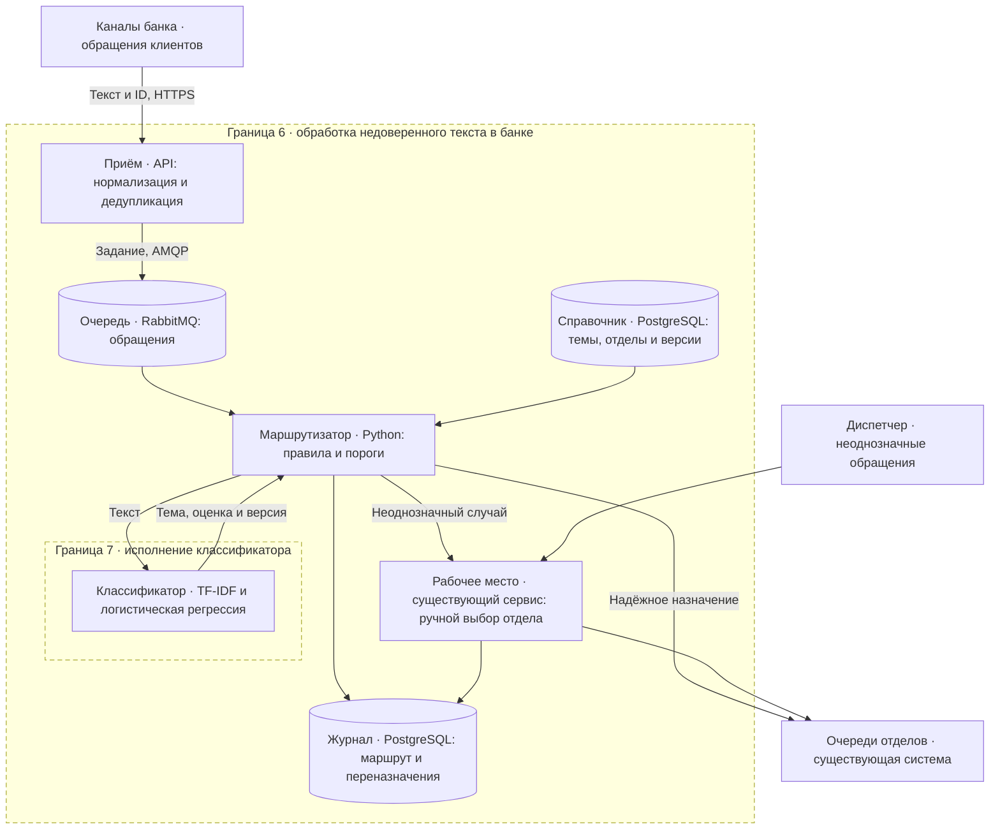

# Архитектуры двух дополнительных инициатив

## №18. Извлечение финансовых показателей

Первый вариант: разбор файла или OCR → текстовая модель → проверка → подтверждение сотрудником. Прямую обработку документа мультимодальной моделью сравниваем на тех же документах по качеству, времени проверки и полной стоимости.

Выделенный контур — предложение для пилота, а не уже согласованная услуга. Реальные документы передаются только после допуска ИБ, DPO и юристов. Без допуска сохраняется ручной процесс.

Контекст берётся только из текущего документа или пакета заявки. Поиск по всей базе банка и агент с инструментами не нужны. Модель не имеет доступа к кредитной системе.

| Параметр | Решение |
|---|---|
| Режим | Асинхронный; повтор по ID документа, хешу и версиям конвейера |
| Результат | Показатель, значение, период, валюта, единица, документ, страница и фрагмент |
| Нет данных | `null` со статусом `absent`, `unreadable` или `conflict` |
| Проверка | Схема, наличие источника, единицы, период, арифметические связи и противоречия |
| Автоматизация | Подготовка полей; критичные показатели в пилоте подтверждает андеррайтер |
| Фолбэк | Нет источника, конфликт, ошибка OCR/модели или тайм-аут → ручной разбор |
| Ограничение | Извлечение не подтверждает подлинность документа и не решает вопрос кредита |

Подтверждённые поля повторно проходят валидатор. Ошибка сотрудника не становится обучающим эталоном без проверки.

## №5. Маршрутизация обращений

Сохраняется допущение Task2: обращения содержат свободный текст, а выбранная клиентом тема не позволяет надёжно определить отдел.

| Параметр | Решение |
|---|---|
| Режим | Асинхронный; назначение идемпотентно по ID обращения |
| Результат модели | `request_id`, тема, оценка уверенности, версия |
| Бизнес-результат | Очередь отдела по справочнику или очередь диспетчера |
| Проверка | Известная тема, активный отдел, совпадение ID и версии справочника |
| Порог | Подбирается по каждой теме на validation-наборе под точность не ниже 95% |
| Автоматизация | Назначение отдела для допущенных тем; ответы клиенту не генерируются |
| Фолбэк | Низкая уверенность, несколько тем, неизвестная тема или отказ → диспетчер |
| Приоритет | Обязательные правила срочности выполняются независимо от модели |

Если надёжную маршрутизацию обеспечивает тема из формы, оставляем таблицу соответствий и пересматриваем необходимость ML.

## Дополнение к ADR-002 и ADR-003

Для №18 выбран фиксированный конвейер с отдельным разбором документа, проверкой источников и подтверждением критичных полей. Пересмотр — при росте ручных исправлений, изменении модели, OCR или условий провайдера.

Для №5 выбран локальный классификатор с детерминированным назначением отдела. Пересмотр — при изменении тем, снижении точности или появлении достаточного правила без ML.

Это уточняет решения Task2, не меняя выбранные инициативы и критерии качества.
